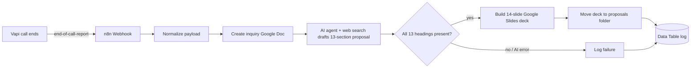

# Vapi Discovery to Proposal

An n8n workflow that turns a finished **Vapi voice discovery call** into a ready-to-review sales package: a Google Docs inquiry, an AI-researched audit and proposal, and a 14-slide Google Slides deck, all logged for tracking.

> Every output is marked `DRAFT - HUMAN REVIEW REQUIRED`. Nothing is sent to the client automatically.

## How it works

1. Vapi sends an `end-of-call-report` to the webhook.
2. The payload is normalized into caller, business, contact, need, systems and transcript.
3. A **Client Discovery Inquiry** Google Doc is created and filled in.
4. An **AI agent** (OpenAI chat model plus Brave web search) drafts a 13-section audit and proposal grounded in the call. Strict rules stop it inventing prices, metrics, guarantees or client facts.
5. The output is validated, then a **14-slide deck** is generated through the Google Slides API.
6. Each run is upserted into the **Discovery Call Log** data table. Failures are logged too.

## Repository structure

| Path | Purpose |
|---|---|
| `workflows/vapi-discovery-to-proposal.json` | Sanitized n8n workflow (import this) |
| `docs/SETUP.md` | Full setup guide |
| `docs/ARCHITECTURE.md` | Node-by-node reference and data model |
| `docs/TROUBLESHOOTING.md` | Common problems and fixes |
| `scripts/check_sanitized.py` | Local and CI check that no secrets or PII are committed |
| `.env.example` | Placeholder reference (no real values) |
| `SECURITY.md` | Security policy and handling of secrets |

## Quick start

1. Import `workflows/vapi-discovery-to-proposal.json` into n8n.
2. Create and select your credentials (Google Docs, Slides, Drive; OpenAI; Brave Search).
3. Replace the `YOUR_*` and `REPLACE_*` placeholders.
4. Create the data table and point Vapi at the **production** webhook URL.

Details are in [docs/SETUP.md](docs/SETUP.md).

## Requirements

- n8n (cloud or self-hosted) with Data Tables
- Google account with Docs, Slides and Drive
- OpenAI and Brave Search API access
- A Vapi assistant with an `end-of-call-report` server message and a structured output

## Security

This repo contains no credentials, webhook URLs, folder IDs or call data; all are placeholders. Never commit a raw n8n export, because pinned execution data can include names, emails, phone numbers and recording links. See [SECURITY.md](SECURITY.md).

## Contributing

See [CONTRIBUTING.md](CONTRIBUTING.md). Run `python3 scripts/check_sanitized.py` before every commit.

## License

[MIT](LICENSE)
